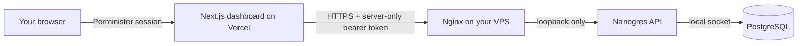

<div align="center">
  
  <h1>Nanogres</h1>
  <p><strong>A private workspace for the Postgres server behind your projects.</strong></p>
  <p>Manage databases, roles, backups, and recovery from one small control panel.</p>
</div>

Nanogres is a self-hosted Postgres management dashboard for personal projects and small teams. The
Next.js app runs on Vercel, while Postgres stays on your VPS. Nanogres gives you a clear view of the
server and a guarded place to handle routine database work.

## What you can do

- **See the state of your server.** Review database sizes, owners, connection counts, server health,
  and recent changes.
- **Manage database storage.** See the space used by all databases, set an individual maximum for
  a user database or leave it on Auto, and monitor remaining room alongside overall VPS disk usage.
- **Keep project access organized.** Create database-scoped read-only and read-write roles, with
  workspace permissions checked on the server for each action.
- **Make and move backups.** Schedule daily backups, download a custom-format dump, or restore a
  trusted `.dump` or `.backup` file into a new database.
- **Review the interface safely.** Open synthetic-data screens, including the getting-started state,
  without signing in or connecting to the VPS.
- **Choose your theme.** Follow the system setting or select light or dark mode.

## How it fits together



The browser talks only to the dashboard. Vercel server functions check your Perminister session and
workspace permission, then call the VPS API over HTTPS. The VPS API token and Postgres credentials
stay out of browser code. PostgreSQL remains on the VPS and is not exposed as a public database
port.

## Connect your VPS

Use a stable HTTPS origin for the Perminister app client and the VPS API. The default API address in
this project is `https://nanogres.duckdns.org:8443`; Nginx uses port 8443 so an existing TURN service
can continue using its ports.

1. **Install the API on the VPS.** As root, run [`vps-api/install-vps.sh`](vps-api/install-vps.sh).
   The service binds to `127.0.0.1:8765`, creates a random bearer token in
   `/etc/nanogres/api.env`, and enables the daily backup timer. It stages, but does not enable, the
   public HTTPS proxy or firewall rule.
2. **Enable the HTTPS proxy.** Confirm that `nanogres.duckdns.org` resolves to the VPS and that a
   trusted certificate is installed. Review [`vps-api/nginx-nanogres.conf`](vps-api/nginx-nanogres.conf),
   enable the Nginx site, validate the configuration, and reload Nginx. Then allow inbound TCP 8443
   in the VPS firewall. Keep PostgreSQL bound to loopback. The detailed installation notes are in
   [`vps-api/install-vps.md`](vps-api/install-vps.md).
3. **Configure Perminister.** Set the product and organization IDs and create an app client for the
   production dashboard origin. Its callback is `<dashboard-origin>/auth/perminister/callback`.
   Keep public registration disabled for this private dashboard.
4. **Set Vercel Production variables.** For one workspace, set `NANOGRES_API_URL` to its HTTPS API
   origin and copy the token from `/etc/nanogres/api.env` into `NANOGRES_API_TOKEN`. For multiple
   workspaces, configure `NANOGRES_WORKSPACE_APIS` with one server-only JSON entry per
   `organizationId` and `workspaceId`; requests fail closed when the selected pair has no entry.
   Keep every API token server-only and never use a `NEXT_PUBLIC_` prefix.
5. **Deploy and sign in.** Deploy the app, sign in through Perminister, then initialize the first
   workspace admin grant if the setup screen requests it.

See [`vps-api/README.md`](vps-api/README.md) for the API routes, backup format, and retention
behavior.

## Develop locally

Requirements: Node.js 24.22 or newer in the 24.x line, pnpm 12.16 or newer, and Python 3 for the VPS API tests.

```sh
pnpm install
pnpm dev
```

Create an ignored `.env.local` file for local configuration. Add the server-only variable names
below with values from your own Perminister app client and VPS. Do not commit that file. Never add
secrets to source code or variables prefixed with `NEXT_PUBLIC_`.

The public welcome page is at `/`; authenticated users land at `/overview`.

Open [`http://localhost:3000/ui-preview`](http://localhost:3000/ui-preview) to browse the screens
without authentication. It is enabled only in development, uses clearly labeled synthetic data,
and has no live VPS actions.

For sign-in, configure a Perminister client whose origin exactly matches your local app origin and
whose callback is `<origin>/auth/perminister/callback`. Production and preview origins need their
own matching Perminister configuration when they are used for sign-in. The login page supports
both Perminister single sign-on and a custom email/username and password form backed by Perminister;
Nanogres does not store the password. Password recovery opens Perminister's recovery page.

### Server-only variables

| Variable                        | Purpose                                                                            |
| ------------------------------- | ---------------------------------------------------------------------------------- |
| `PERMINISTER_URL`               | Perminister service base URL; defaults to `https://www.perminister.com`.           |
| `PERMINISTER_APP_CLIENT_ID`     | Nanogres app client ID.                                                            |
| `PERMINISTER_APP_CLIENT_SECRET` | Server-side app client secret.                                                     |
| `PERMINISTER_PRODUCT_ID`        | Product ID used for workspace authorization.                                       |
| `PERMINISTER_ORGANIZATION_ID`   | Organization that owns the product.                                                |
| `NANOGRES_APP_ORIGIN`           | Exact origin used for sign-in callbacks and cookies.                               |
| `NANOGRES_WORKSPACE_ID`         | Stable ID for this VPS workspace.                                                  |
| `NANOGRES_API_URL`              | HTTPS origin for the VPS management API.                                           |
| `NANOGRES_API_TOKEN`            | Bearer token generated by the VPS installer.                                       |
| `NANOGRES_WORKSPACE_APIS`       | Optional JSON array mapping organization and workspace IDs to API URLs and tokens. |

For multiple workspaces, set `NANOGRES_WORKSPACE_APIS` to a JSON array such as:

```json
[
  {
    "organizationId": "example-org",
    "workspaceId": "production",
    "url": "https://nanogres-prod.example.com",
    "token": "<token-from-that-workspace-installer>"
  },
  {
    "organizationId": "example-org",
    "workspaceId": "staging",
    "url": "https://nanogres-staging.example.com",
    "token": "<token-from-that-workspace-installer>"
  }
]
```

When this variable is set, the app only routes to an exact organization/workspace pair in the list;
the single-workspace URL and token are not used as a fallback. Without it, the single-workspace API
is available only when the selected pair matches `PERMINISTER_ORGANIZATION_ID` and
`NANOGRES_WORKSPACE_ID`.

## Backups and recovery

Nanogres schedules one custom-format PostgreSQL dump per day and retains 14 days on the VPS. You
can also download a backup to your computer and restore a trusted `.dump` or `.backup` file into a
new database. Restore uploads are transferred in chunks; incomplete uploads are removed after 24
hours. Restores never overwrite an existing database.

The scheduled copies share the VPS disk with PostgreSQL. Download a second copy to protect against
loss of that server or disk. A PostgreSQL dump can contain executable SQL from its source, so restore
only files from sources you trust.

## Storage sizing

Nanogres reserves 1 GiB for the system and makes 25% of the remaining free volume available for
database growth. Custom database maxima use that shared budget first; databases left on Auto share
what remains. The VPS API setting `NANOGRES_DATABASE_GROWTH_PERCENT` changes the percentage. The
dashboard shows the combined size of all databases (including `postgres`), per-database usage and
effective limits, and overall volume free space. The combined total uses PostgreSQL's per-database
size report; the per-database quota meter uses allocated blocks when hard quotas are verified.

Custom maxima are stored by the VPS API and enforced with ext4 project quotas. If available space
shrinks below custom requests, Nanogres reduces the effective caps to preserve the shared growth
budget and reports the constraint in the dashboard. Without verified filesystem quotas, sizing
targets remain advisory. See [`vps-api/README.md`](vps-api/README.md) for details.

## Repository checks

RepNix provides repository guardrails. The test command runs authorization mapping and isolated VPS API recovery and HTTP tests; it does not require a running Postgres instance. Run the checks before proposing a change:

```sh
pnpm test
pnpm health:audit
pnpm health
pnpm typecheck
pnpm lint
pnpm format:check
pnpm build
```

## Project layout

- `src/app/` — Next.js pages, authentication callbacks, and server-side API routes.
- `src/components/dashboard/` — dashboard shell, synthetic preview screens, and live VPS screens.
- `src/lib/` — Perminister authorization and the server-side VPS API client.
- `vps-api/` — Python API, systemd services, Nginx configuration, and VPS installation notes.

## Operational review

Nanogres marks an off-site copy stale when it has not been successfully verified for 36 hours, and
shows a warning after a newer failed upload. An optional VPS webhook alert service sends a notice
when this state changes and a recovery notice after a fresh verified copy. Configure its HTTPS
endpoint and payload format in the root-owned `/etc/nanogres/backup.env`; keep the alert endpoint
and bearer token out of Vercel and source control. The dashboard continues to show the same status,
and the VPS API remains private.

Verify restores regularly against a separate non-production Postgres instance; an uploaded or
off-site copy is not proof that a backup can be restored. Check that the daily systemd backup timer
ran, inspect the backup and off-site service journals, review available disk, and verify the newest
archive with `pg_restore --list` before performing a restore drill. The VPS installation notes list
the exact service commands. Restore a trusted dump into a disposable database, confirm a known
table or row, then remove that test database.

The activity file is a local operational record, not a tamper-resistant audit trail: it resides on
the VPS, and unreadable or malformed activity currently appears as an empty list. Protect and
monitor the state directory and retain independent logs when audit guarantees are required.
